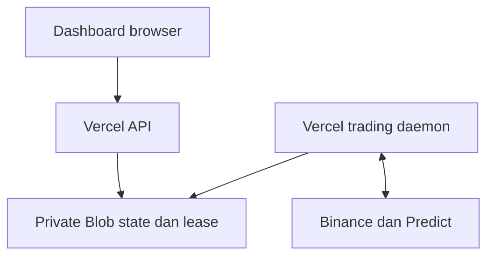

# PredictFun Quant — build Vercel

Dashboard + API berjalan sebagai Vercel Functions. Engine bot berjalan sebagai **satu Vercel Daemon**, dengan koneksi pasar dan state yang dipisahkan dari request browser. Ledger, konfigurasi, perintah, dan lease worker disimpan di **Vercel Blob private** menggunakan ETag conditional writes.

Paket ini dimulai dalam **paper mode, auto-trade berhenti**. Trading baru diaktifkan melalui kontrol dashboard setelah data dan penyimpanan siap. Kredensial wallet tidak dibutuhkan untuk paper.

## Deploy di Vercel

1. Buka [Vercel Drop](https://vercel.com/drop), unggah ZIP proyek ini, pilih team dan nama project, lalu deploy. Vercel Drop mendukung source ZIP dan build framework. Jika diminta pengaturan: **Other**, Node.js **24.x**, Build Command `npm run build`, Output Directory `public`, Install Command `npm ci`. Alternatif: unggah source ke Git dan Import Project. Root Directory harus folder teratas, bukan subfolder. Konfigurasi `daemons` ada di `vercel.json`; periksa build log worker pada deployment produksi.
2. Buat/connect **Vercel Blob private**, sebaiknya region Tokyo `hnd1`. Hubungkan ke project. Pastikan environment produksi mendapat `BLOB_STORE_ID`. SDK memakai OIDC Vercel; daemon membaca token terbaru setiap operasi. Untuk penggunaan lokal dapat memakai `BLOB_READ_WRITE_TOKEN` server-side.
3. Tambahkan environment produksi `BOT_CONTROL_TOKEN` acak minimal 24 karakter. Untuk mengizinkan tombol **Mulai Live**, set `ENABLE_LIVE_TRADING=true`; nilai `false` adalah kill switch server yang memblokir aktivasi live. Key Predict dan wallet dapat diisi melalui menu aplikasi setelah deploy, tanpa dimasukkan ke environment satu per satu. Jangan memakai key dari ZIP awal.
4. Deploy ke **Production**. Preview deployments hanya menjalankan dashboard/API; Vercel Daemons belum berjalan di preview.
5. Buka URL deployment dan login memakai `BOT_CONTROL_TOKEN`. Untuk uji paper, pilih **PAPER**, isi `PREDICT_FUN_API_KEY`, lalu simpan. Private key dan account address tidak diperlukan. Tunggu konfirmasi **TERSIMPAN** dan heartbeat daemon sebelum **Mulai paper**. Untuk live, pilih setup **LIVE**, isi API key, `WALLET_PRIVATE_KEY`, dan `PREDICT_ACCOUNT_ADDRESS` (deposit address smart account). Untuk EOA, kosongkan account address; alamat signer diturunkan dari private key. Simpan, tunggu worker mengakui revisi kredensial, lalu gunakan tombol **Mulai Live**. **Pause** menghentikan entry baru; pemantauan dan exit posisi tetap diperlukan.

Alternatif deploy lewat CLI Vercel yang mendukung Daemons (64.3.0 atau lebih baru):

```bash
npm ci
npm run check
npx vercel@latest login
npx vercel@latest --prod
```

Setelah environment/storage berubah, deploy ulang produksi. Jangan meletakkan private key/API key ke kode, repository, `public`, atau environment berawalan `NEXT_PUBLIC_`/`VITE_`.

## Cara kerja



API hanya membaca snapshot serta mengantrekan kontrol; API tidak membuka koneksi trading dan tidak memulai engine. Worker membaca kontrol secara serial dan memberikan status applied/failed. Dashboard membedakan heartbeat worker, data pasar, dan auto-trade yang aktif.

`npm run build` membundel semua modul lokal API menjadi entry ESM `api/handler.js`. File hasil build ini disertakan di Git agar Function dapat dilacak sebelum build berjalan. Rewrite eksplisit meneruskan seluruh `/api/*`, termasuk rute bertingkat, ke entry yang sama. `npm run test:native` mengimpor entry tersebut dengan Node langsung tanpa loader TypeScript.

Satu dokumen CAS menyimpan state dan lease. Worker lama tidak boleh menimpa worker baru saat restart/rollout. Intent order disimpan sebelum submit. Sesudah signing/auth dan sebelum setiap HTTP submit, worker memeriksa lease kembali. Kehilangan lease atau kegagalan storage menghentikan entry/submit baru; order yang belum pasti harus direkonsiliasi.

Daemon tidak menerima HTTP. Tidak ada cron ping atau loop bot yang diselipkan ke Functions. Filesystem container tidak dipakai sebagai ledger cloud. Deployment tidak membuat approvals, redeem, atau transaksi dana sungguhan secara otomatis.

## Menjalankan lokal

```bash
npm ci
cp .env.example .env
npm run build
npm run dev
```

Windows PowerShell: `Copy-Item .env.example .env`. Dashboard lokal tersedia di `http://127.0.0.1:3000`. Isi token operator dan storage development yang terpisah dari produksi.

Worker dijalankan di terminal lain:

```bash
npm run start:worker
```

Atau build container lokal dari **root proyek**, karena Dockerfile memakai build context root:

```bash
docker build -f Dockerfile.worker -t predict-fun-worker .
docker run --env-file .env --init predict-fun-worker
```

`vercel dev` tidak menjalankan daemon. Gunakan `BOT_OFFLINE=true` saat memeriksa worker tanpa koneksi pasar; label dashboard tetap menunjukkan mode offline. Jangan memakai namespace/storage produksi untuk tes lokal. `BOT_STATE_NAMESPACE` memisahkan dokumen state, default `predict-fun/v1`.

## Batas dan operasional

- Vercel Daemons masih **Public Beta** dan hanya berjalan di Production. Konfigurasi paket menjaga satu instance `hnd1`, 1 GiB; lease tetap diperlukan karena rollout bisa melibatkan dua proses.
- Hobby dibatasi **5 Active CPU-hours/bulan** untuk Daemons. Saat kuota habis, Vercel menghentikan daemon hingga bulan berikutnya atau perubahan plan. Pro/Enterprise mengenakan biaya compute; Blob mempunyai kuota/biaya penyimpanan dan operasi sendiri. Pantau Usage; paket tidak mengubah plan/billing akun.
- Snapshot daemon diperbarui setiap 2 detik dan status dashboard diperiksa setiap 1 detik; ini terpisah dari pemrosesan tick pasar. Membuka dashboard dan menjalankan daemon memakai operasi Blob, jadi pantau Usage. Tidak ada jaminan latensi, ketersediaan data venue, matching, atau waktu cancel.
- Dokumen cloud dibatasi 4 MiB. Jika penuh, worker gagal tertutup; ekspor/arsipkan ledger sebelum melanjutkan. Jangan menghapus ledger aktif untuk mengatasi error karena berisi pending orders dan counter risiko.
- Stop harian memakai tanggal UTC (07.00 WIB). Pause menghentikan entry baru; proses rekonsiliasi dan exit posisi yang sudah ada perlu tetap berjalan.
- State cloud dimulai kosong; histori lama tanpa mode tidak diimpor sebagai bukti performa live. Key lama di ZIP awal tidak disertakan.

## Menu kredensial dan live

Tiga input tersedia di dashboard: `PREDICT_FUN_API_KEY`, `WALLET_PRIVATE_KEY`, dan `PREDICT_ACCOUNT_ADDRESS`. Pilihan PAPER hanya memakai API key dan menyimpan bundle tanpa signer; bundle ini tidak dapat menghasilkan bukti autentikasi atau mengaktifkan live. Pilihan LIVE membutuhkan private key yang valid. Input key disembunyikan, hanya dikirim melalui API operator, lalu dikosongkan. Lihat status TERSIMPAN, bukan isi kolom yang dikosongkan, untuk memeriksa penyimpanan. API tidak pernah mengirim kembali nilai key ke browser. Password operator hanya berada di memori tab. Gunakan URL HTTPS Vercel.

Kredensial disimpan sebagai ciphertext AES-256-GCM di Blob private. Kunci enkripsi berasal dari `BOT_CREDENTIALS_KEY` server (opsional, 64 karakter hex) atau diturunkan dari token operator dengan salt per envelope. Jika token operator diubah tanpa kunci enkripsi terpisah, kredensial perlu dimasukkan ulang. Error dekripsi menghentikan submit, bukan beralih diam-diam ke key lain.

Penyimpanan kredensial baru mem-pause entry. Rotasi ditolak selama ada posisi/order live yang belum selesai agar key wallet lama tidak hilang sebelum rekonsiliasi. Worker mengikat pemeriksaan autentikasi ke revisi kredensial; keberadaan key saja tidak membuktikan koneksi aktif.


Profitabilitas strategi belum dibuktikan. Confidence adalah skor heuristik dan model fair price masih memakai asumsi volatilitas tetap. PnL/fee merupakan estimasi konservatif sampai cocok dengan receipt settlement, saldo, gas, dan redeem.

Live membutuhkan `ENABLE_LIVE_TRADING=true` di server dan kredensial baru melalui menu aplikasi atau environment. Smart account memakai deposit address `PREDICT_ACCOUNT_ADDRESS`; EOA memakai alamat signer yang diturunkan dari private key. Approvals exchange harus sudah tersedia. Pergantian mode ditolak bila meninggalkan posisi pada mode lain; timeout tidak dianggap zero fill. Browser tidak menyimpan private key ke localStorage; form hanya mengirimnya saat penyimpanan melalui endpoint operator terenkripsi HTTPS. Private key tidak masuk kode publik, log, response API, atau ledger plaintext.

Jika muncul status rekonsiliasi, periksa order hash dan saldo/receipt di Predict. Jangan mengirim ulang atau menghapus catatan secara manual tanpa menyelesaikan rekonsiliasi. Backup state sebelum pemulihan. `/orders/remove` hanya menghapus dari orderbook; signature on-chain masih bergantung pada expiry/invalidasi.

## Pemeriksaan

`npm run check` menjalankan TypeScript, tes deterministik, build dashboard/API/daemon, serta tes HTTP entry Function dengan Node langsung. Tes tidak memakai kredensial produksi dan tidak membuat order sungguhan. `VALIDATION.md` mencatat pemeriksaan yang benar-benar selesai beserta hal yang belum bisa diverifikasi.

Jika dashboard menampilkan `FUNCTION_INVOCATION_FAILED`, Function gagal dimulai sebelum login. Periksa `/api/health`: endpoint ini harus mengembalikan JSON HTTP 200 tanpa token. HTTP 401 pada endpoint operator berarti API sudah merespons tetapi token belum valid; HTTP 503 dengan `STORAGE_NOT_CONFIGURED` berarti storage perlu dihubungkan. Keberhasilan health tidak membuktikan daemon atau trading live sudah berjalan.

## Referensi resmi

- [Vercel Drop](https://vercel.com/drop)
- [Alur ZIP dan build Vercel Drop](https://vercel.com/kb/guide/vercel-drop-vs-netlify-drop)
- [Vercel Daemons](https://vercel.com/docs/daemons)
- [Konfigurasi Daemons](https://vercel.com/docs/daemons/config-reference)
- [Kuota dan batas Daemons](https://vercel.com/docs/daemons/limits)
- [Vercel Blob](https://vercel.com/docs/vercel-blob)
- [Predict API](https://dev.predict.fun/)

Versi ini disiapkan untuk deployment Vercel. Keberhasilan build lokal tidak sama dengan keberhasilan build container/deployment di akun Vercel.
